# 🎨 Artworks & Visual Portfolio

Welcome to my personal art showcase. This repository hosts a curated collection of original visual pieces, vector illustrations, typographic compositions, and graphic designs created by **Zed**.

---

## 🖼️ Gallery

### 1. Wing of Tear (なみだ の つばさ)
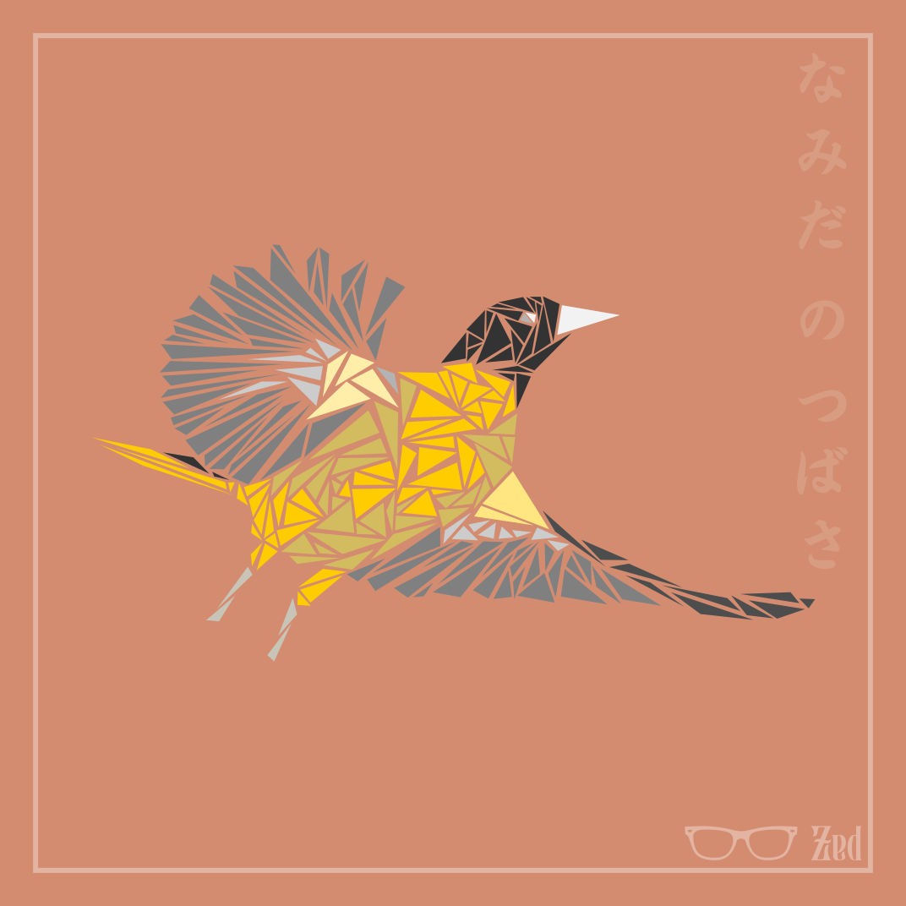

> **Description:** A geometric low-poly bird in flight, crafted with intricate warm-toned facets and Japanese script.

---

### 2. Allay
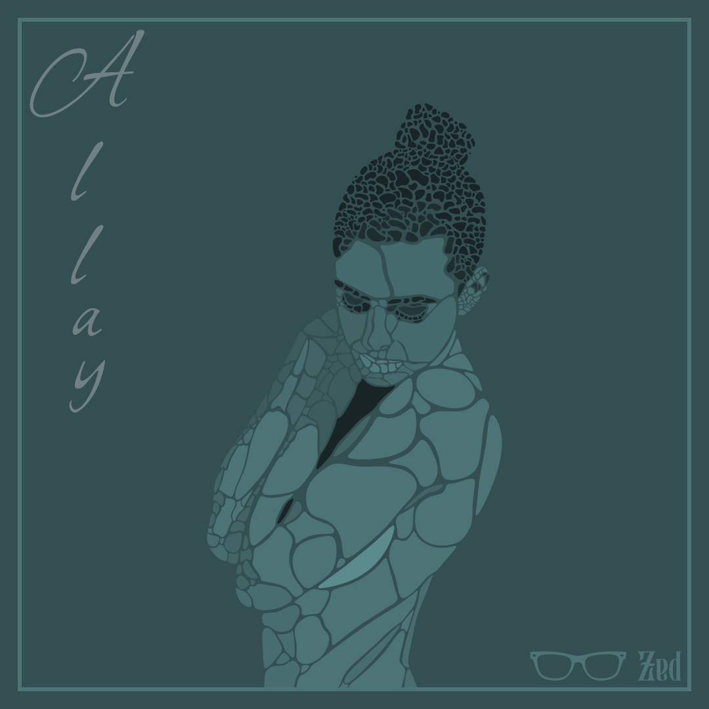

> **Description:** A stylized mosaic vector portrait exploring serenity and vulnerable human form through organic teal segments.

---

### 3. Being a Nihilist
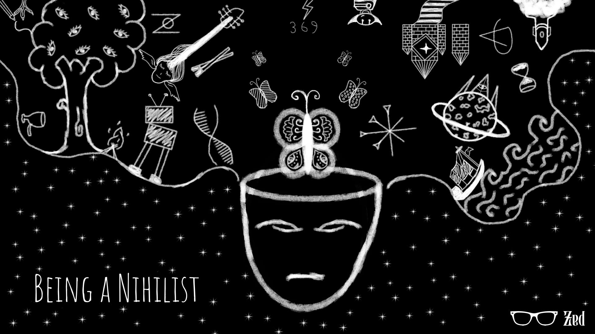

> **Description:** A surreal chalkboard-style cosmic illustration depicting an open mind brimming with eccentric thoughts and existential musings.

---

### 4. Mutatio Fati
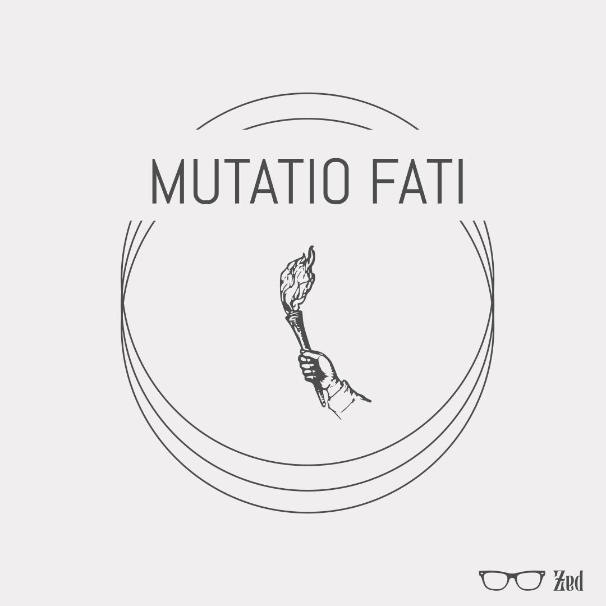

> **Description:** A minimalist classical emblem featuring a hand raising a flaming torch inside concentric rings, representing the courage to alter one's destiny.

---

### 5. Runic Eye of Providence
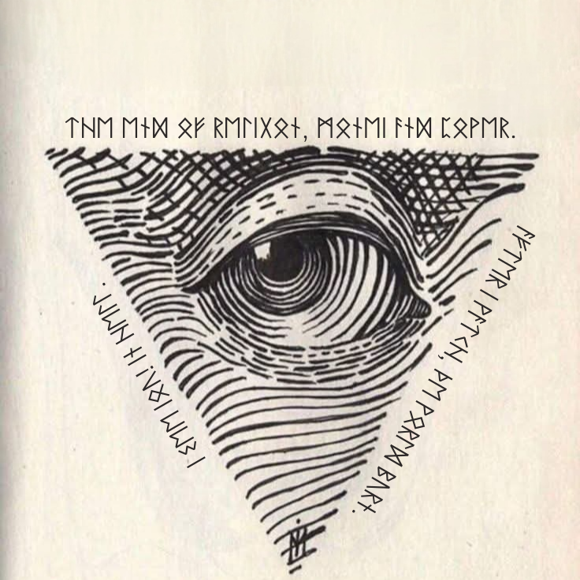

> **Description:** A detailed woodcut-inspired engraving of an all-seeing eye framed within an inverted triangle and elder runes.

---

### 6. I Hate Small Talk
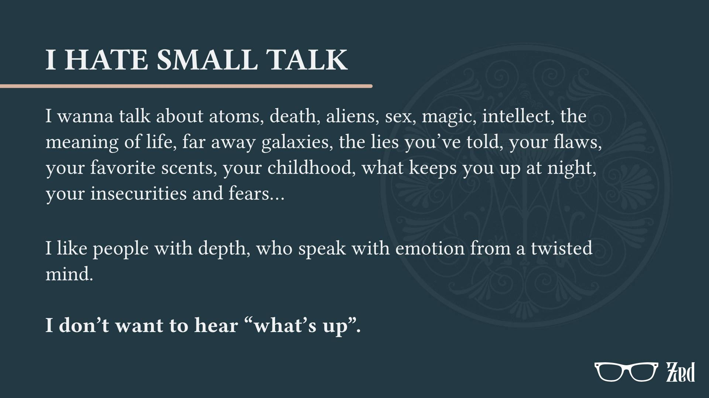

> **Description:** A refined dark typographic manifesto rejecting superficial pleasantries in favor of conversations with real depth.

---

### 7. Walk in Eternity
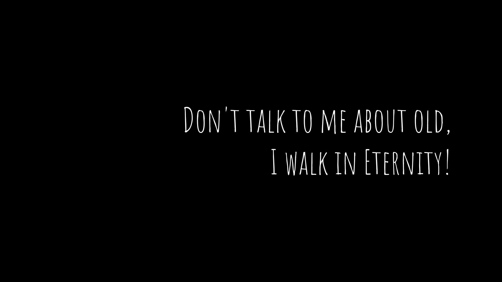

> **Description:** A stark, minimalist typographic artwork meditating on timelessness and age against an infinite black void.

---

### 8. Pain: The Cycle of War
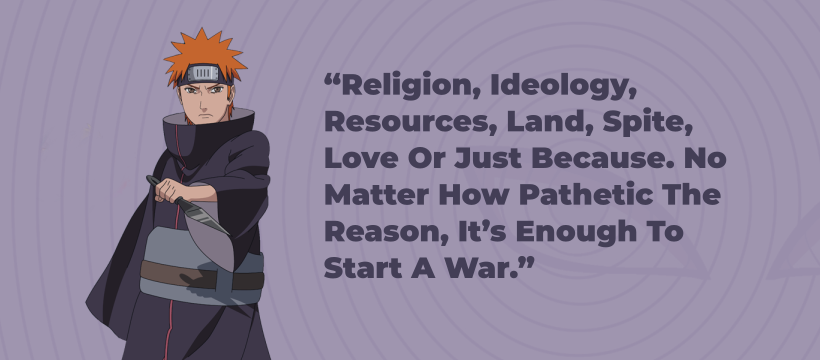

> **Description:** A widescreen character banner featuring Nagato (Pain) with his poignant quote on the inevitable excuses for conflict.

---

### 9. Zed Identity
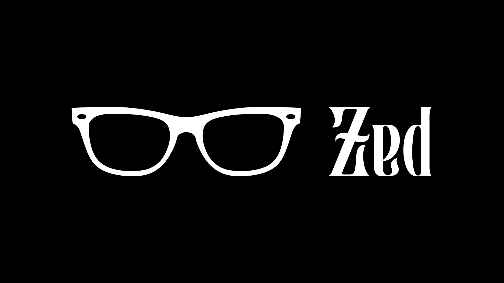

> **Description:** The signature personal brandmark juxtaposing classic serif lettering with minimalist spectacles.

---

### 10. Bloooop Academy — Boundless Learning
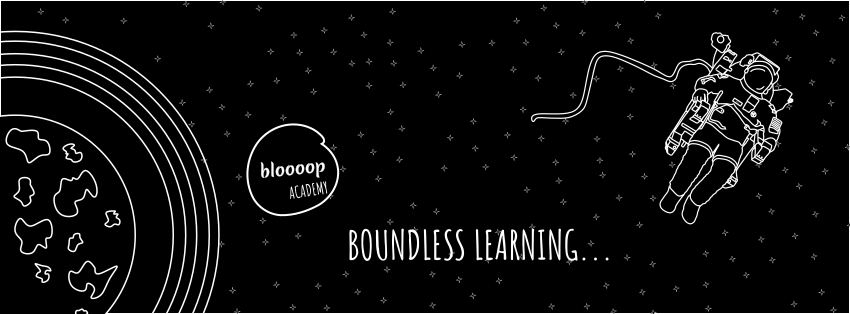

> **Description:** A cosmic line-art banner featuring a floating astronaut and planetary orbits, symbolizing limitless curiosity.

---

### 11. Bloooop Echo — The Voice of You
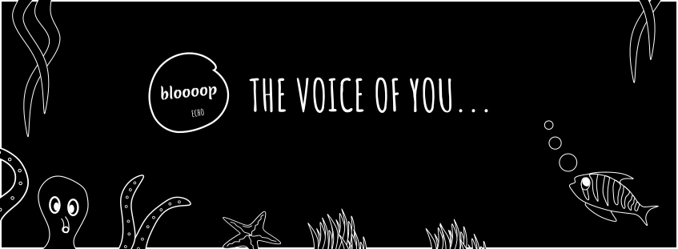

> **Description:** An underwater deep-sea line-art illustration with marine life, celebrating individuality and expression.

---

### 12. We Are Not Finished (Obsidian // 02)
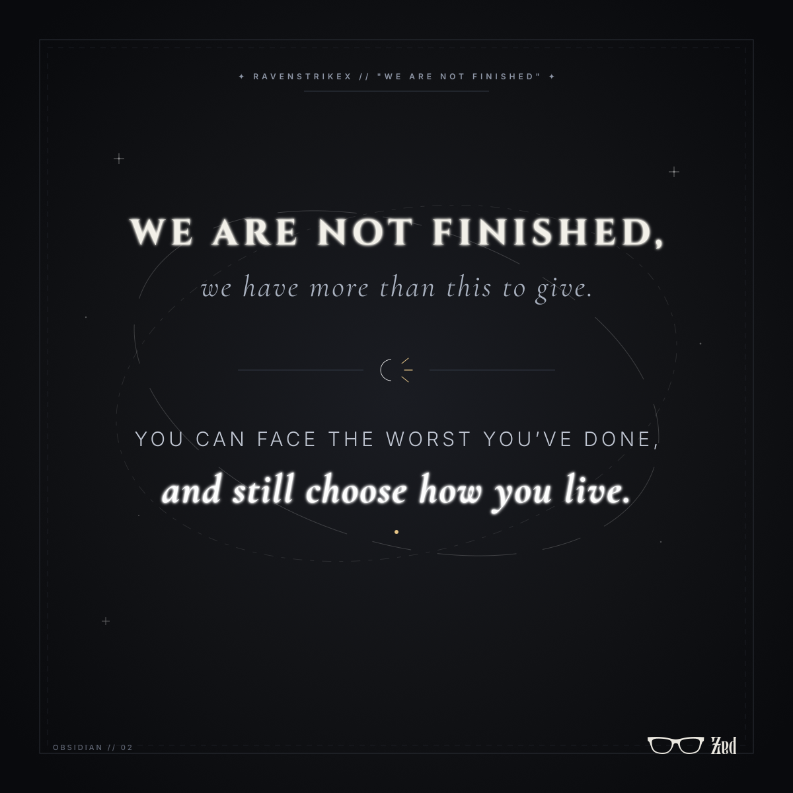

> **Description:** An evocative dark editorial typographic artwork on resilience, redemption, and choosing how to live.

---

## 📌 About & Rights

All artworks in this repository are personal creative projects by **Zed**. Feel free to browse and explore.
